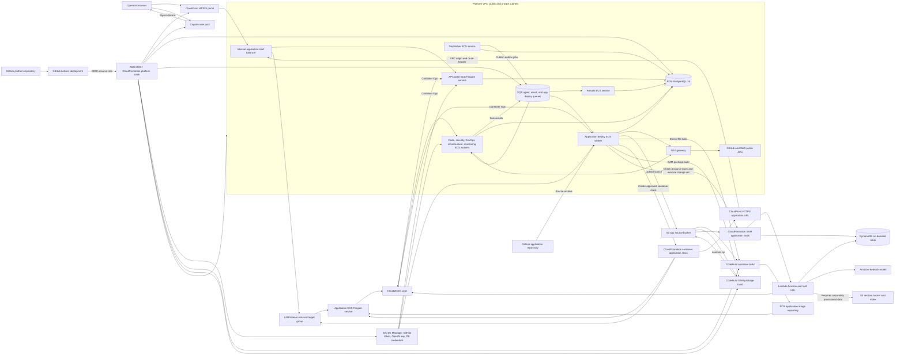

# AWS resource flow

This diagram compares the code pushed to `main` and `feature/sam-repository-deployment`. It describes the staging configuration in `infra/app.py` and the application stacks created by `src/agents_platform/app_aws.py`. It does not show which resources currently exist in AWS.

| Branch | Application deployment path |
| --- | --- |
| `main` | Root Dockerfile → CodeBuild → ECR → ECS Fargate, shared ALB routing, and application CloudFront URL |
| `feature/sam-repository-deployment` | Keeps the Dockerfile path and adds a restricted root SAM template → separate CodeBuild project → Lambda, on-demand DynamoDB, and IAM-protected Function URL |

The SAM path is proposed in a draft PR and is not part of `main`. This file does not establish whether a branch has been deployed to AWS.

## Deployment and status flow

1. The operator signs in through Cognito, submits a GitHub repository and target settings, and reviews the generated resource plan in the portal. Creating a plan does not create AWS resources. An administrator must approve deployment.
2. After approval, the application deploy worker uploads the pinned source to S3. The Dockerfile path builds and pushes an image to ECR. The SAM path packages a Lambda zip in a separate CodeBuild project.
3. The container path waits for a CloudFormation change set and checks the application's HTTP health path after stack creation. The SAM path additionally checks the change set's resource types before execution and invokes the Lambda with an invalid request as a limited smoke check. `RUNNING` does not establish Bedrock access or working S3 Vectors retrieval. Its Function URL requires a SigV4-signed request; opening it directly in a browser returns 403.
4. The portal reads application state from the platform database. GitHub Actions and CloudFormation record platform deployment status; CodeBuild, CloudFormation, ECS events, Lambda logs, and CloudWatch Logs provide application details.

## Cost and cleanup boundaries

- The platform keeps a NAT gateway, RDS instance, load balancer, and Fargate services running while staging is up. These are ongoing costs even when no application is deployed.
- A Dockerfile application adds a Fargate service and CloudFront distribution. A SAM application adds Lambda requests, an on-demand DynamoDB table, and Bedrock usage when called. CodeBuild charges for builds; ECR and S3 charge for retained data. The platform S3 source bucket has a one-day object expiration rule.
- Portal deletion removes the application CloudFormation stack, its ECR repository for containers or S3 zip artifact for SAM, and the temporary source archive. Platform teardown deletes managed application stacks and tagged ECR repositories before destroying the platform stack; with teardown enabled, the platform S3 bucket is emptied. S3 Vectors is created outside this platform and needs separate cleanup. A Lambda log group created on first invocation may also remain after deleting a SAM stack; verify it in CloudWatch Logs. Check retained data and AWS billing after cleanup.
- To reduce chat usage, watch GitHub Actions for platform deployments and use the portal's status page plus AWS Console events and logs for application deployments. Chat polling is unnecessary for routine status tracking.
