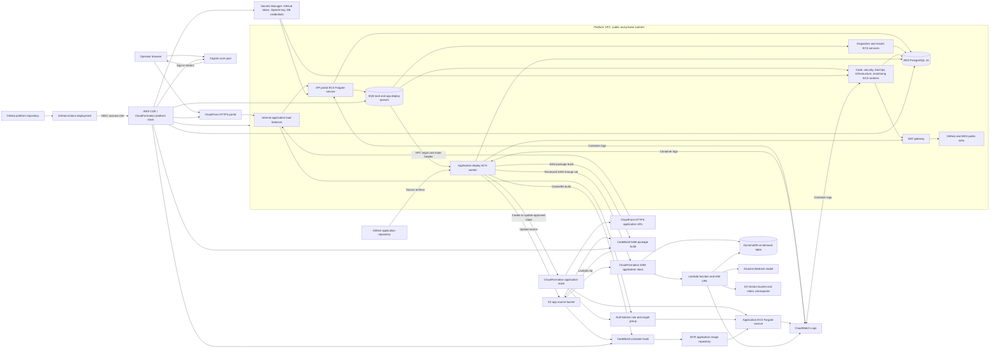

# AWS resource flow

This diagram describes the staging architecture in `infra/app.py` and application stacks created by `src/agents_platform/app_aws.py`. A Dockerfile application gets ECS, ALB routing, and CloudFront resources. A supported SAM application gets Lambda, DynamoDB, and an IAM-protected Function URL. Both use the platform API, database, queue, and application deploy worker.

## Deployment and status flow

1. The operator signs in through Cognito, submits a GitHub repository and target settings, and reviews the generated resource plan in the portal.
2. After approval, the application deploy worker uploads the pinned source to S3. The Dockerfile path builds and pushes an image to ECR. The SAM path packages a Lambda zip in a separate CodeBuild project.
3. The worker checks the CloudFormation change set before creating the application stack. It checks the container health path or invokes the Lambda for a limited smoke check before reporting success. Bedrock and S3 Vectors need separate functional verification.
4. The portal reads application state from the platform database. GitHub Actions and CloudFormation record platform deployment status; CodeBuild, CloudFormation, ECS events, and CloudWatch Logs record application deployment details.

## Cost and cleanup boundaries

- The platform keeps a NAT gateway, RDS instance, load balancer, and Fargate services running while staging is up. These are ongoing costs even when no application is deployed.
- A Dockerfile application adds a Fargate service and CloudFront distribution. A SAM application adds Lambda requests, an on-demand DynamoDB table, and Bedrock usage when called. CodeBuild charges for builds; ECR and S3 charge for retained data.
- Delete application stacks and their ECR repositories or SAM zip artifacts through the portal or project cleanup tooling. The platform cleanup command removes the platform stack and managed application resources. S3 Vectors is a separate prerequisite and requires separate cleanup if created. Check retained data and AWS billing after cleanup.
- To reduce chat usage, watch GitHub Actions for platform deployments and use the portal's status page plus AWS Console events and logs for application deployments. Chat polling is unnecessary for routine status tracking.
